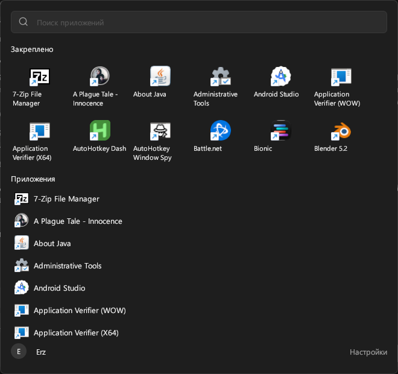

# OpenStart

<div align="center">

**Ein Startmenü für Windows 10/11 — eigener Win-Tastenhaken, eigene Stile, eigene Suche.**

[English](README.md) · [Русский](README.ru.md) · **Deutsch** · [Français](README.fr.md) · [Español](README.es.md) · [中文](README.zh-CN.md) · [日本語](README.ja.md)

[](https://github.com/Erzkanzler2k/OpenStart/releases)
[](https://github.com/Erzkanzler2k/OpenStart/actions/workflows/ci.yml)
[](#voraussetzungen)
[](#aus-dem-quellcode-bauen)
[](LICENSE)

</div>



Eine einzige Rust-Exe. Kein Installer, keine Dienste, keine Admin-Rechte, keine
Fremdsoftware. Die App hakt die Win-Taste ab, liest die vorhandenen Windows-Verknüpfungen
und zeichnet das Menü selbst.

## Funktionen

- **Win öffnet, Win schließt** — ebenso Esc, ein Klick daneben oder das Starten eines
  Programms. Ohne Neustart, ohne Shell-Ersatz.
- **Auch die Start-Schaltfläche** — ein Klick darauf öffnet dieses Menü statt des
  Systemmenüs. Der allererste Klick kalibriert die Position der Schaltfläche.
- **Echte Programme** — liest die Startmenü-Ordner (alle Benutzer und aktueller Benutzer),
  zeigt echte Symbole und sucht beim Tippen nach Namen.
- **Sieben Stile** — Windows 7, Modern, Windows 10, Windows 11, Windows App, Windows Pro,
  Windows 10X. Jeder von Grund auf gezeichnet, kein Skin.
- **Im Infobereich** — keine Taskleisten-Schaltfläche, kein Eintrag in Alt+Tab. Linksklick
  öffnet das Menü, Rechtsklick bietet *Menü öffnen*, *Einstellungen*, *Beenden*. Das Symbol
  übersteht einen Neustart von `explorer`.
- **Eine Instanz** — ein zweiter Start öffnet nur die Einstellungen der laufenden App
  (`OpenStart.exe --settings`).
- **Einstellungen** — sechs Bereiche mit Stilvorschauen, Schaltern und einem Regler. Alles
  wirkt sofort.
- **Angeheftete Kacheln** — Rechtsklick auf eine App heftet sie an oder löst sie;
  die Reihenfolge ist deine.
- **Autostart** — ein Schalter unter *Verwalten*; er setzt genau einen `Run`-Eintrag
  für den Benutzer.
- **Win-Kombinationen bleiben** — Win+E, Win+R, Win+X und weitere gehen ans System.

| Stile | Einstellungen |
| --- | --- |
|  |  |

## Installation

1. `OpenStart.exe` aus den [Releases](https://github.com/Erzkanzler2k/OpenStart/releases)
   herunterladen.
2. Starten. Das Symbol erscheint im Infobereich.
3. **Win** drücken — das Menü öffnet sich.
4. Dauerhaft verfügbar? Unter **Verwalten** „Beim Anmelden starten“ einschalten.

Ist das Symbol versteckt, unter **Einstellungen → Personalisierung → Taskleiste → Weitere
Symbole im Infobereich** aktivieren.

## Bedienung

| Aktion | So |
| --- | --- |
| Durch die Ergebnisse | **↑ / ↓** |
| Auswahl starten | **Enter** |
| Menü öffnen / schließen | **Win** |
| Schließen ohne Start | **Esc**, Klick daneben |
| Einstellungen öffnen | Symbol im Infobereich → *Einstellungen* oder das Zahnrad im Menü |
| Beenden | Symbol → *Beenden* oder **Verwalten → Beenden** |
| Stil wechseln | Bereich *Startmenü*, auf eine Karte klicken |

## Konfiguration

Einstellungen liegen in `%APPDATA%\OpenStart\config.json`: `style` (0–6), `dark`, `alpha`,
`show_search`, `tiles`, `recent`, `pinned`, `start_x`/`start_y` (gemerkte Position der
Start-Schaltfläche; löschen, um sie neu zu lernen).

## Voraussetzungen

- Windows 10 oder Windows 11 (x64).
- Keine Adminrechte, kein Installer, keine Laufzeitumgebung.

## Aus dem Quellcode bauen

```powershell
cargo build --release
cargo test --release
.\target\release\openstart.exe
```

Rust 1.75+ mit MSVC-Toolchain.

## Wie es funktioniert

- Ein Low-Level-Tastaturhaken (`WH_KEYBOARD_LL`) fängt Win ab. Der Tipp wird geschluckt,
  damit das Systemmenü zu bleibt; beginnt eine Kombination, wird ein synthetischer
  Win-Tastendruck gesendet und das System behandelt sie normal.
- Das Menü ist ein rahmenloses egui-Fenster am unteren Bildschirmrand. Die Einstellungen
  nutzen dasselbe Fenster in einem anderen Modus.
- Die Programmliste entsteht aus den Startmenü-Ordnern (`.lnk`); Symbole kommen von der
  Windows-Shell.
- Der Hintergrund ist ein Screenshot des Desktops unter dem Menü, verkleinert und wieder
  gestreckt — Acryl-Look aus einem Standbild, kein Live-Blur.
- Das Infobereich-Symbol nutzt `Shell_NotifyIcon` mit eigenem verstecktem Fenster und Menü;
  nach einem `explorer`-Neustart trägt es sich per `TaskbarCreated` neu ein.
- Die Konfiguration liegt in `%APPDATA%\OpenStart\config.json`.

## Grenzen

- Die Taskleiste selbst wird nicht ersetzt: nur Klicks auf die Start-Schaltfläche werden
  abgefangen, alles andere bleibt beim System.
- Windows 11 ignoriert eigene Verknüpfungen in `WinX\Group3`, daher kein Win+X-Eintrag.
- Keine UWP-Apps ohne Startmenü-Verknüpfung.
- Kein manuelles Anheften oder Verschieben von Kacheln.
- Kein Ersatz für Sperrbildschirm, Datei- oder Websuche.

## Bekannte Konflikte

- Anti-Cheat- und Sicherheitssoftware, die globale Tastaturhaken blockiert, kann das
  Abfangen von Win verhindern.
- Solange OpenStart läuft, öffnet Win dieses Menü statt des Systemmenüs — das ist der Sinn.

## Status

Getestet unter Windows 11: Öffnen und Schließen mit Win, Suche, Programmstart, Stilwechsel,
Speichern der Einstellungen, Win+E, Infobereich-Symbol und Kontextmenü, `explorer`-Neustart,
einzelne Instanz mit `--settings`, Klick auf die Start-Schaltfläche. Nicht getestet:
andere Tastaturlayouts, Windows 10, mehrere Monitore, DPI-Wechsel.

## Lizenz

MIT — siehe [LICENSE](LICENSE).
