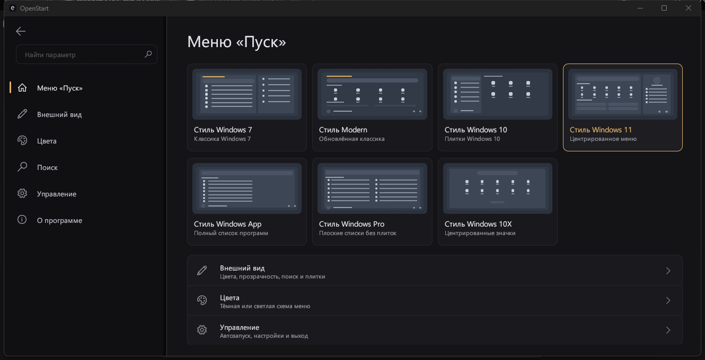

# OpenStart

<div align="center">

**A Start menu for Windows 10/11 — its own Win key hook, its own styles, its own search.**

[English](README.md) · [Русский](README.ru.md) · [Deutsch](README.de.md) · [Français](README.fr.md) · [Español](README.es.md) · [中文](README.zh-CN.md) · [日本語](README.ja.md)

[](https://github.com/Erzkanzler2k/OpenStart/releases)
[](#requirements)
[](#build-from-source)
[](LICENSE)

</div>


A single Rust executable. No installer, no services, no registry writes, nothing else
required. It hooks the Win key, reads the shortcuts Windows already has, and draws the
menu itself.

## Features

- **Win to open, Win to close** — also Esc, a click outside, or launching an app.
  No reboot, no shell replacement.
- **Your real apps** — reads the Start Menu folders (all users and current user),
  shows real icons, searches by name as you type.
- **Seven styles** — Windows 7, Modern, Windows 10, Windows 11, Windows App,
  Windows Pro, Windows 10X. Each one is drawn from scratch, not a skin.
- **Tray resident** — no taskbar button, no Alt+Tab entry. Left click opens the menu,
  right click gives *Open menu*, *Settings*, *Exit*. The icon survives an `explorer`
  restart.
- **One instance** — a second launch just opens settings in the running app
  (`OpenStart.exe --settings`).
- **Settings** — six sections with style previews, switches and a slider. Everything
  applies immediately.
- **Autostart** — a switch in *Manage*, no registry tinkering.
- **Win chords still work** — Win+E, Win+R, Win+X and friends are forwarded to the
  system.

| Styles | Settings |
| --- | --- |
|  |  |

## Install

1. Download `OpenStart.exe` from [Releases](https://github.com/Erzkanzler2k/OpenStart/releases).
2. Run it. The icon appears in the notification area.
3. Press **Win** — the menu opens.
4. Want it always available? Turn on *Launch at sign-in* in **Manage**.

If the tray icon is hidden, enable it in **Settings → Personalization → Taskbar →
Other system tray icons**.

## Usage

| Action | How |
| --- | --- |
| Open / close the menu | **Win** |
| Close without opening anything | **Esc**, click outside |
| Open settings | Tray icon → *Settings*, or the gear in the menu footer |
| Quit | Tray icon → *Exit*, or **Manage → Exit** |
| Change style | *Start menu* section, click a card |

## Requirements

- Windows 10 or Windows 11 (x64).
- No admin rights, no installer, no runtime.

## Build from source

```powershell
cargo build --release
.\target\release\openstart.exe
```

Rust 1.75+ with the MSVC toolchain.

## How it works

- A low-level keyboard hook (`WH_KEYBOARD_LL`) catches Win. The tap is swallowed so
  the system menu stays closed; when a chord starts, a synthetic Win keypress is sent
  so the system handles it as usual.
- The menu is a borderless egui window at the bottom of the screen. Settings reuse the
  same window in another mode.
- The app list is built by walking the Start Menu folders (`.lnk` files); icons come
  from the Windows shell.
- The backdrop is a screenshot of the desktop under the menu, downscaled and stretched
  back — an acrylic look from a static image, not live blur.
- The tray icon is `Shell_NotifyIcon` with its own hidden window and menu; after an
  `explorer` restart it re-adds itself on `TaskbarCreated`.
- Configuration lives in `%APPDATA%\OpenStart\config.json`.

## Limitations

- The taskbar is not replaced: the Start button stays system-owned, the menu is opened
  by the Win key or the tray icon.
- Windows 11 ignores custom shortcuts in `WinX\Group3`, so no Win+X entry is added.
- No UWP apps that have no Start Menu shortcut.
- No manual tile pinning or drag and drop.
- No lock screen, file search or web search replacement.

## Known conflicts

- Anti-cheat and security software that blocks global keyboard hooks can stop the Win
  key from being intercepted.
- While OpenStart is running, Win opens this menu instead of the system one — that is
  the point.

## Status

Tested on Windows 11: opening and closing with Win, search, launching apps, switching
styles, saving settings, Win+E, tray icon and its context menu, `explorer` restart,
single instance with `--settings`. Not tested: other keyboard layouts, Windows 10,
multiple monitors, DPI changes.

## License

MIT — see [LICENSE](LICENSE).
