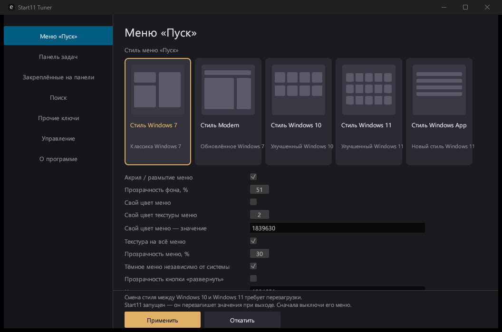
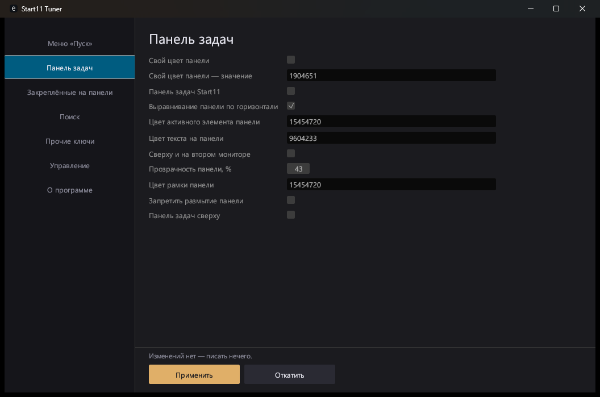

# OpenStart11

Редактор настроек [Start11](https://www.stardock.com/products/start11/) для
Windows 10/11. Показывает **все** значения, которые Start11 хранит в реестре,
человеческими подписями и применяет их без перезагрузки.

Один exe на Rust, без установки, без служб и без внешних скриптов.



## Что умеет

- **Все настройки из ключа Start11.** Список контролов строится по фактическому
  содержимому `HKCU\Software\Stardock\Start8\Start8.ini\Start8`: `0`/`1` —
  галочка, число — счётчик, остальное — поле ввода. Обычно это 37 значений.
- **Человеческие подписи**; сырое имя ключа — в подсказке при наведении.
- **Пять стилей меню** карточками: Windows 7, Modern, Windows 10, Windows 11,
  Windows App.
- **Пишет только изменившееся.** Если ничего не трогал — ничего не пишет.
- **Бэкап перед записью** в `%LOCALAPPDATA%\Start11Tuner` (JSON) и откат из него.
- **Применение без перезагрузки**: запись → попытка закрыть Start11 →
  перезапуск `explorer.exe` → окно закрывается. Перезагрузка нужна только при
  смене стиля между Windows 10 и Windows 11 — этого требует сам Start11.
- **Понятно работает без Start11**: если ключа нет, окно объясняет это и не
  даёт ничего записать.



## Запуск

Готовый `OpenStart11.exe` — в [Releases](../../releases). Распаковать и запустить,
права администратора не нужны: всё пишется в `HKCU`.

Из исходников:

```powershell
cargo build --release
.\target\release\openstart11.exe
```

Нужен Rust 1.75+ и MSVC Build Tools.

## Перед применением

Выйди из меню Start11 через его трей. Запущенный `Start11_64.exe` перезаписывает
настройки при выходе, и закрыть его программно нельзя — процесс защищён.

## Чего приложение не делает

- Не активирует Start11, не обходит лицензию и не генерирует ключи.
- Не редактирует закреплённые элементы: они лежат в подключах `Right`/`RightMode`
  в неразобранном формате.
- Не показывает цветовые ползунки: часть цветовых ключей (`S11_MaxColour`,
  `CustomColourV`) не подтверждена, поэтому они остаются числом.

Служебные значения (лицензия, кэш, флаги первого запуска и миграций) скрыты и не
пишутся.

## Как это выяснено

Настройки Start11 3.x живут в ветке-наследнике Start8
`HKCU\Software\Stardock\Start8\Start8.ini\Start8`, все значения — строки.
Порядок стилей снят с ресурсов `Start11Config.exe`: Windows 7, Modern,
Windows 10, Windows 11, Windows App. Подробности и старая версия на
PowerShell — в [`legacy/`](legacy/).

## Статус

Проверено: запись значений, бэкап/откат, перезапуск explorer, отсутствие
Start11. Не проверено: как каждый ключ влияет на само меню — для этого нужна
активированная копия Start11.
